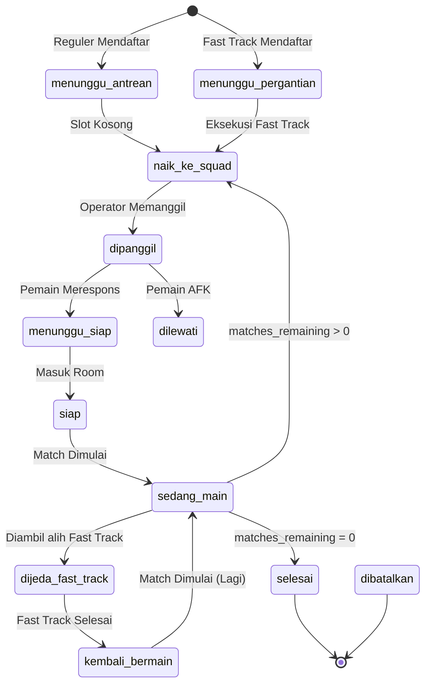

# Transisi Status Joka Joki

Dokumen ini menjelaskan daftar status dan aturan transisi (perubahan status) untuk entitas utama dalam sistem Joka Joki.

---

## 1. Status Mabar Entry (`mabar_entries.status`)

Kolom `status` pada tabel `mabar_entries` adalah penunjuk mutlak posisi pemain dalam siklus hidup sesi Mabar.

### Daftar Status

| Status | Keterangan |
|--------|------------|
| `menunggu_antrean` | (Reguler) Sedang berada di dalam daftar tunggu antrean biasa. |
| `menunggu_pergantian` | (Fast Track) Menunggu antrean Fast Track untuk masuk menggantikan pemain aktif. |
| `naik_ke_squad` | Sistem menandai bahwa slot telah tersedia untuknya, tapi pemain belum di-invite ke in-game. |
| `dipanggil` | Operator sudah memanggil nama/nickname pemain di stream. Menunggu respons pemain. |
| `menunggu_siap` | Pemain merespons, sedang proses masuk room. |
| `siap` | Pemain sudah berada di dalam room in-game MLBB. |
| `sedang_main` | Game dimulai. `active_slot` terisi. |
| `dijeda_fast_track` | Pemain reguler yang ditarik keluar sementara (di-*kick* dari room) untuk memberikan slot kepada Fast Track. |
| `kembali_bermain` | Pemain yang dijeda dipanggil kembali ke dalam room setelah Fast Track selesai bermain. |
| `dilewati` | Pemain tidak merespons panggilan (AFK) atau menolak main. Otomatis masuk daftar antrean bawah atau di-skip sesuai kebijakan. |
| `selesai` | Sisa match (`matches_remaining`) mencapai 0. Masuk riwayat. |
| `dibatalkan` | Pembelian di-refund atau pesanan dicancel secara manual. |

### Diagram Transisi Status Mabar Entry

---

## 2. Status Match (`matches.status`)

Melacak siklus per pertandingan tunggal.

| Status | Keterangan |
|--------|------------|
| `menunggu` | Match dibuat, pemain sedang dikumpulkan ke dalam room. |
| `sedang_berjalan` | Match resmi dimulai (masuk loading screen / land of dawn). |
| `selesai` | Match berakhir (Victory/Defeat). Memicu pengurangan `matches_remaining`. |
| `dibatalkan` | Match gagal jalan (Invalid, ada yang AFK awal, remake). |

---

## 3. Status Fast Track Replacement (`fast_track_replacements.status`)

Siklus hidup penjepitan (pergantian) pemain reguler oleh pemain Fast Track.

| Status | Keterangan |
|--------|------------|
| `menunggu` | Hubungan terbentuk di database, tetapi FT belum masuk game (misal menunggu match saat ini selesai). |
| `aktif` | FT resmi menduduki `active_slot` pemain reguler. Pemain reguler masuk status `dijeda_fast_track`. |
| `selesai` | FT telah menghabiskan semua match-nya. FT masuk Riwayat (`selesai`). Slot dikembalikan ke pemain reguler. |
| `dibatalkan` | Transaksi FT direfund/dibatalkan sebelum dieksekusi tuntas. Pemain reguler dikembalikan ke slotnya tanpa pengurangan apa-apa. |

---

## 4. Status Live Session (`live_sessions.status`)

Status global sesi live streamer.

| Status | Keterangan |
|--------|------------|
| `belum_dimulai` | Sesi di-schedule, tapi antrean belum dibuka. |
| `aktif` | Antrean terbuka, stream berjalan, pendaftaran aktif. |
| `istirahat` | Streamer istirahat (pause sementara), match dihentikan sesaat, pendaftaran mungkin ditutup. |
| `selesai` | Streamer menyudahi sesi. Semua sisa antrean dianggap hangus (atau dilanjutkan esok hari, tergantung kebijakan organisasi). |
| `dibatalkan` | Sesi batal berjalan (listrik mati, stream error). |
